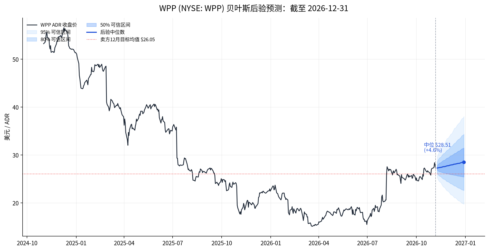

# WPP 贝叶斯走势分析：截至 2026-12-31

> **分析日**：2026-11-08 ｜ **价格数据截止**：2026-11-06 美股收盘 ｜ **标的**：WPP plc（NYSE: WPP / LSE: WPP.L）  
> **口径说明**：本文把“截止 12.31”理解为 **2026-12-31**，预测窗口为 2026-11-09 至 2026-12-31 的 37 个交易日。价格以 NYSE ADR（1 ADR = 5 股普通股）为主，按 GBP/USD 1.3385 折算为伦敦便士。  
> **一句话结论**：贝叶斯后验中位数 **$28.51（约 426p）**，较现价 $27.26 高 **4.6%**；50% 可信区间 **$25.41–$31.48（约 380–470p）**，80% 可信区间 **$22.61–$34.34（约 338–513p）**。方向偏多，但优势很薄——核心矛盾是“Elevate28 转型动量”与“阳狮数据霸权 + 卖方目标价已低于现价”的拉扯。

---

## 1. 结论先行

| 指标 | 结果 |
|---|---|
| 现价（2026-11-06） | **$27.26 / ADR**，折合约 **407p** |
| 期末后验中位数 | **$28.51 / ADR**，折合约 **426p** |
| 期末后验均值 | $28.55 / ADR |
| 50% 可信区间 | **$25.41–$31.48**（约 380–470p） |
| 80% 可信区间 | $22.61–$34.34（约 338–513p） |
| 95% 可信区间 | $19.73–$38.05（约 295–569p） |
| 期末高于现价概率 | **61.0%** |
| 突破 52 周高点 $28.77 概率 | 47.5% |
| 跌破 $25 概率 | 22.2% |
| 跌破 $22 概率 | 8.0% |
| 期望收益（37 个交易日） | **+4.7%** |
| 中位收益 | +4.6% |

**判断**：这不是“确定性看多”，而是“**中性偏多、右尾略厚、左尾不薄**”。现价已经反映了相当一部分转型预期：2026 年至今 ADR 从 $22.91 涨到 $27.26（**+19.0%**），过去 6 个月涨 **+43.7%**，52 周低点 $14.80 以来接近翻倍。此时再追，需要新的催化剂；而阳狮的 LiveRamp“小作文”正好打在 WPP 最敏感的“数据基础设施”叙事上。

---

## 2. 现价与基本面快照

### 2.1 价格与估值

| 项目 | 数值 | 说明 |
|---|---|---|
| ADR 现价 | $27.26 | 2026-11-06 收盘，Nasdaq/Futunn/雪球三源一致 |
| 伦敦普通股隐含价 | 约 407p | $27.26 ÷ 5 ÷ 1.3385 × 100 |
| 总市值 | **$5.88B / £4.40B** | 1.08B 普通股；ADR 口径 2.157 亿份 |
| 2026E P/E | **约 8.0x** | 2026E EPS 51.0p（BofA） |
| 2026E FCF Yield | **约 5.3%** | 每股 FCF 约 21.5p |
| 股息率 | **约 3.7%** | 2025 全年股息 15p |
| 52 周区间 | $14.80–$28.77 | 现价距高点仅约 -5.2% |
| 卖方 12 个月目标 | **$26.05 / 约 386–389p** | 17 位分析师：4 Buy / 9 Hold / 4 Sell |
| 目标价区间 | $16.83–$36.94 / 250–555p | 分歧极大 |

**关键观察**：卖方平均目标价 **低于现价**。这不是“便宜得没人要”，而是“股价跑在分析师模型前面”。TipRanks 的 8 位分析师平均目标 386.25p，TradingView 的 14 位平均 $26.05，折算后都在 386–389p 附近，较 407p 低约 4–5%。高盛 275p、UBS 250p、BofA 250p 看空；Deutsche Bank 555p、Berenberg 470p 看多。**目标价分布本身说明这是一只“叙事驱动、分歧巨大”的股票**。

### 2.2 2026 Q3：方向对，但斜率仍弱

WPP 2026 Q3（2026-10-29 发布）的核心数据：

| 指标 | Q3 2026 | 同比/环比 |
|---|---|---|
| 营收 | £3.274B | +0.5% reported / +0.5% LFL |
| 营收（扣除转嫁成本） | £2.411B | **-2.1% LFL**（Q2 为 -2.8%，Q1 为 -6.7%） |
| WPP Media | — | **+0.3% LFL**，两年来首次转正（Q1 -8.3%，Q2 -2.8%） |
| WPP Creative | — | **-5.1% LFL**（Q2 -3.5%，继续恶化） |
| WPP Production | — | +2.5% LFL（Q2 +1.3%） |
| 北美 | — | -1.8%（环比改善） |
| 英国 | — | -1.2% |
| 德国 | — | +2.4%（恢复增长） |
| 中国 | — | -8.7%（Q2 曾 +15.6%，公司称是时间性因素） |
| 印度 | — | +2.9%（恢复增长） |
| 中东与非洲 | — | -12.4% |

**指引**：2026 下半年“营收扣除转嫁成本”低至中个位数下降，Q4 处于区间较好一端；全年 headline 营业利润率 **12–13%**；2026 年结构性成本节约 **£100M**，2027 年年化 **£250M**，2028 年 **£500M**；2027 年恢复有机增长。平均调整后净债务 **£3.2B**，所有债务到期覆盖至 2028 年，90% 利息固定。

**新业务**：续约可口可乐全球媒体、数据、技术和创作者营销（不含北美、日本、韩国；未参与北美比稿）；DoorDash 全球媒体扩展至 40 多个市场；Waymo 北美和 EMEA 媒体代理；雀巢中国端到端内容模式。**这些是“信任票”，但还不足以抵消 Creative 的持续下滑和客户流失的基数效应**。

---

## 3. 阳狮的“Instagram 小作文”到底在说什么

### 3.1 事件本身

2026-11-02，阳狮集团（Publicis Groupe）完成对 LiveRamp 的收购：

- 企业价值约 **$2.167B**，股权价值约 **$2.546B**，每股 $38.50 现金；
- 把 LiveRamp 的企业级数据协作平台与 Epsilon 的身份识别能力合并，推出所谓“业界首个即插即用 AI growth engine”；
- LiveRamp 保留品牌、团队和“中立性”，CEO Scott Howe 直接向 Arthur Sadoun 汇报；
- FTC 在 2026-10-19 接受同意令：未来 **5 年**，LiveRamp 需以公平、合理、非歧视条件向所有客户（包括阳狮竞争对手的客户）提供独立服务，并设置数据防火墙和独立审计。

随后，Sadoun 在公开表态和 WSJ 专访中释放了两层信息：

1. **“张开双臂欢迎”**：Omnicom 和 WPP 如果愿意，可以继续使用 LiveRamp；
2. **“没有你们也行”**：竞争对手的广告集团合计只占 LiveRamp 收入 **不到 5%**，LiveRamp 可以在失去这些客户的情况下继续运转。

这就是市场口中的“小作文”：**表面上是中立性安抚，实质上是权力展示**。翻译成大白话：  
> “你们可以继续用，但你们不是不可或缺的；数据身份层现在在我手里。”

### 3.2 对 WPP 的三层影响

| 层级 | 影响 | 方向 |
|---|---|---|
| **数据基础设施依赖** | WPP 及旗下媒介代理使用 LiveRamp/RampID 做跨平台身份匹配。现在这一层归竞争对手所有。FTC 的 5 年承诺提供短期保护，但 2031 年后的续约、定价、优先级存在不确定性。 | 中期负面 |
| **叙事竞争** | 阳狮用“Epsilon + LiveRamp + 客户自有数据”讲 AI 故事；WPP 的 WPP Open、Open Intelligence 需要证明“我也有独特数据资产”，否则容易被看成“用对手的管道做 AI”。 | 短期负面 |
| **客户预算** | 阳狮 2026 年 9 月无 pitch 拿下百事全球媒体（约 $17 亿），说明“能力审查”正在替代传统比稿；WPP 守住可口可乐全球（除北美），但北美被 Omnicom 拿走。客户“换仓”是真实存在的。 | 中性偏负 |

### 3.3 但不要把它读成“胜负已定”

- **FTC 的中立性约束是硬约束**：5 年 FRAND 访问、防火墙、独立审计。阳狮不能明目张胆地断供或差别定价。
- **WPP 有替代方案**：Omnicom 已在加速转向 Acxiom 的 Real ID；WPP 也可以自建/切换。LiveRamp 不是唯一身份层。
- **WPP 的 Q3 有真实改善**：Media 两年来首次转正、Coca-Cola 续约、DoorDash/Waymo/雀巢新业务，说明客户并没有因为“阳狮小作文”而集体逃跑。
- **阳狮自己也有估值压力**：UBS 在 2026-11-06 把阳狮下调至 Neutral，目标价从 €109 降到 €100，理由是“股价可能接近天花板、AI 带来定价风险”。**“小作文”不等于阳狮的股价会一直赢**。

**结论**：阳狮的 LiveRamp 举动是 **WPP 左尾风险的放大器**，不是立即的盈利冲击。它让 WPP 的“数据自主”叙事变得更贵、更急，也给 WPP 的 2027 复苏故事加了一个“竞争对手先手”的折扣。

---

## 4. 贝叶斯模型：怎么算的

### 4.1 数据与目标

- 样本：WPP ADR 日收盘价，**2020-11-02 至 2026-11-06**，共 1,511 个交易日；其中 2026 年至今 214 个交易日。
- 目标：模拟 **37 个交易日**后的期末价格分布（2026-12-31）。
- 收益率：对数日收益；价格：ADR 美元。

### 4.2 三个组件

| 组件 | 模型 | 作用 | 先验/设定 |
|---|---|---|---|
| **A1 常数漂移 + Student-t** | $r_t = \mu + \sigma \epsilon_t$，$\epsilon_t \sim t_5$ | 稳健的“漂移锚”，避免追逐短期动量 | $\mu \sim N(0.0003, 0.0008^2)$，$\sigma$ 半正态；2026 YTD 数据更新 |
| **B 局部线性趋势 DLM** | 对数价格 = 局部水平 + 局部趋势；卡尔曼滤波 + 边际似然网格 | 捕捉“转型动量/趋势” | 方差参数带半正态先验，网格后验加权 |
| **C 分析师目标桥** | 12 个月目标 $26.05，按 37/252 线性收敛；2 个月不确定性 15% | 引入卖方共识作为“均值回归锚” | 目标区间 $16.83–$36.94，取约 ±2σ |

**模型平均权重**：A1 **50%**、B **30%**、C **20%**。  
这不是拍脑袋的“三个模型取平均”，而是有明确的贝叶斯含义：用先验/后验对“稳定漂移”“趋势外推”“卖方锚”分别加权，避免单一模型在 2 个月窗口里过度外推。权重偏重 A1，是因为 WPP 的 2025 年刚刚经历 -56% 的断裂，2026 年的高波动（年化约 53%）不适合把 6 个月的动量线性外推。

### 4.3 为什么用 Student-t

WPP 2026 年的月度收益极端：3 月 -16.4%、4 月 +16.3%、6 月 -16.7%、7 月 +30.5%、8 月 +26.6%。正态分布会低估这种厚尾；Student-t（ν=5）让模型对极端日收益更宽容，预测区间更诚实。

### 4.4 各组件的结果

| 组件 | 期末中位数 | 80% 区间 | 关键参数 |
|---|---|---|---|
| A1 常数漂移（2026 YTD） | **$27.55（+1.1%）** | $21.75–$34.90 | 漂移 6.6%/年；日波动 2.34% |
| B 局部趋势 DLM（2026 YTD） | **$30.21（+10.8%）** | $26.45–$34.61 | 局部趋势 67%/年 |
| C 分析师目标桥 | **$27.11（-0.6%）** | $21.79–$32.37 | 12 个月目标 $26.05 |
| **50/30/20 混合后验** | **$28.51（+4.6%）** | **$22.61–$34.34**（80%）；$25.41–$31.48（50%） | — |

**注意**：混合后的中位数（+4.6%）高于三个中位数的简单加权平均（约 +3.6%），因为 B 组件的右尾更厚，混合分布是偏态的。这正是“概率分布”而不是“点预测”的意义。

### 4.5 后验分布图

---

## 5. 后验概率：市场在赌什么

| 期末事件 | 概率 | 含义 |
|---|---|---|
| 高于现价 $27.26 | **61.0%** | 略偏多，但不到“高置信” |
| 突破 52 周高点 $28.77 | 47.5% | 几乎五五开；需要新催化 |
| 站上 $30（约 449p） | 36.6% | 需要 Q4 指引上修或分析师追价 |
| 站上 $35（约 524p） | 8.1% | 需要“2027 增长提前定价”的叙事 |
| 跌破 $25（约 374p） | 22.2% | 约五分之一概率；对应 Q4 不及预期/客户流失 |
| 跌破 $22（约 329p） | 8.0% | 尾部风险；对应宏观广告砍单或阳狮抢客户 |
| 跌破 $20（约 299p） | 2.9% | 极端尾部；接近 2026 年 3 月低点区域 |

**读法**：市场当前价格已经计入了“转型继续改善”的基准情形。真正有赔率的不是“看多到 35”，而是“**Q4 指引如果只是符合预期，股价可能横盘甚至回吐**”；上行需要额外的正惊喜，下行则只需要一个客户流失或宏观广告预算的坏消息。

---

## 6. 情景分析：三种 12 月 31 日

| 情景 | 主观概率 | 期末 ADR | 期末 LSE | 触发条件 |
|---|---|---|---|---|
| **下行：叙事破裂** | **20%** | $20–25 | 300–375p | Q4 营收低于指引区间；Creative 继续 -5% 以上；阳狮挖走 WPP 前 25 大客户之一；宏观广告预算在 Q4 砍单；分析师集体下调 |
| **基准：慢修复** | **50%** | $26–31 | 390–460p | Q4 处于指引“较好一端”；Media 保持正增长；Coca-Cola 续约顺利过渡；无重大客户流失；分析师目标价逐步上修至现价附近 |
| **上行：重估加速** | **30%** | $32–37 | 480–555p | 2027 年增长被提前定价；Q4 新业务净影响转正；阳狮整合 LiveRamp 出现客户反弹；WPP 被并购/私有化猜测升温；空头回补 |

情景概率与模型概率大致对齐：模型 P(<$25)=22%，对应下行 20%；P(>$30)=37%，对应上行 30%。**基准 50% 是“最可能但不激动”的路径**。

---

## 7. 催化剂与验证点

### 7.1 未来 8 周

1. **Q4 交易更新 / 2026 全年业绩**（预计 2027 年 2 月底）：管理层明确说 2027 年恢复有机增长，这是最大的二元事件。若 Q4 落在指引较好一端，且 2027 指引不保守，股价有机会挑战 $30–32。
2. **新业务净影响**：Q3 的新业务仍是净拖累（老客户流失的基数效应）。Q4 是否转正，是“转型是否真的见效”的硬指标。
3. **可口可乐北美过渡**：北美业务转给 Omnicom 后，WPP 是否保住其他可乐remit、是否出现执行问题。
4. **阳狮 LiveRamp 整合的客户反应**：FTC 5 年承诺是底线；如果 WPP/Omnicom 公开宣布加速迁移，LiveRamp 的“中立性”叙事会受损，反过来减轻 WPP 的压力。
5. **分析师目标价**：当前平均目标低于现价。若 Q4 后出现一轮上修，会形成“目标价追股价”的正反馈；反之，若目标价继续下调，股价会承压。

### 7.2 中期（2027）

- **Elevate28 的成本节约**：2026 年 £100M、2027 年化 £250M、2028 年 £500M。成本节约的“再投资比例”决定利润率弹性。
- **WPP Open / Open Intelligence 的差异化**：能否证明“自研数据+AI”不是用对手的管道；这是阳狮“小作文”真正想打击的点。
- **并购/私有化**：WPP 的低估值、现金流和品牌资产一直吸引 PE 猜测，但高净债务（£3.2B）和养老金负债是障碍。可视为尾部期权，不是基准。

---

## 8. 风险与局限

1. **2 个月预测的噪声极大**：95% 区间 295–569p，几乎覆盖了“腰斩”到“+40%”的全部可能。任何点预测都不应被当成目标价。
2. **模型只用了价格**：没有把 Q3 财报、客户流失、阳狮事件作为硬变量；这些通过“情景概率”和“定性判断”体现，不是精确的因果估计。
3. **ADR/普通股/汇率折算误差**：1 ADR = 5 股，GBP/USD 用 2026-11-06 的 1.3385；实际交易价差、ADR 溢价、股息税都会造成偏差。
4. **股息未计入**：模型是价格收益，不含 3.7% 股息率；若按总回报，期末中枢会高约 0.6%。
5. **数据源时点**：分析师目标价来自 TipRanks/TradingView，可能滞后；Q3 数据来自公司公告，已交叉验证。
6. **阳狮“小作文”是叙事信号，不是财报科目**：它影响的是估值倍数和左尾，不是下季度 EPS。不要把它当成“已经丢单”的证据。
7. **不是投资建议**：本文是研究分析，不构成买卖建议。

---

## 附录 A：关键数据交叉验证

| 数据点 | 来源 1 | 来源 2 | 差异/结论 |
|---|---|---|---|
| ADR 现价 | Nasdaq $27.26 | Futunn $27.26 / 雪球 $27.26 | 一致 |
| 总市值 | $5.88B（$27.26 × 2.157 亿 ADR） | Futunn $5.88B / 雪球 $5.82B | 差异 <1%，ADR 口径/股本取整 |
| LSE 隐含价 | 407.3p（ADR 折算） | 2025 年报：2025-12-31 337.5p；2026-03-12 235.2p | 2026 年大幅反弹，现价约 407p 合理 |
| 52 周高/低 | Futunn $28.77 / $14.80 | MarketBeat $28.03 / $14.81 | 高点差异为盘中 vs 收盘 |
| 分析师目标 | TradingView $26.05（14 位） | TipRanks 386.25p（8 位）≈ $25.85 | 差异约 0.8% |
| Q3 营收 | 公司 £3.274B | 媒体 £3.27B | 一致 |
| 市值验算 | $27.26 × 2.157 亿 = $5.88B | 报告 $5.88B | 偏差 0.00% ✅ |
| LSE 市值验算 | 407.3p × 10.8 亿 = £4.40B | 报告 £4.40B | 偏差 0.03% ✅ |
| P/E / FCF / 股息 | 407.3p ÷ 51p = 7.99x | FCF yield 5.28%；股息率 3.68% | 工具验算 ✅ |

## 附录 B：模型与复现

- 脚本：[bayes_final.py](file:///workspace/reports/wpp-bayes-20261108/bayes_final.py)
- 结果：[summary.json](file:///workspace/reports/wpp-bayes-20261108/summary.json)
- 图表：[wpp_bayes_fan.png](file:///workspace/reports/wpp-bayes-20261108/wpp_bayes_fan.png)
- 数据：[wpp_adr.json](file:///workspace/reports/wpp-bayes-20261108/wpp_adr.json)
- 方法：A1 用 201×151 网格后验 + 30,000 条 Student-t 路径；B 用 14×12×12 方差网格 + 卡尔曼滤波边际似然 + 20,000 条 DLM 路径；C 用 15,000 条目标桥路径；按 50/30/20 混合成 40,000 条路径。随机种子固定，结果可复现。

## 附录 C：主要来源

- [WPP Q3 2026 trading update / earnings call transcript](https://reportify.cn/transcripts/1313245324948672512)
- [Marketing Dive: WPP Media posts first growth in 2 years](https://www.marketingdive.com/news/wpp-media-posts-first-growth-in-2-years-as-turnaround-stays-on-track/873447/)
- [Publicis Groupe completes LiveRamp acquisition (press release)](https://www.manilatimes.net/2026/11/03/tmt-newswire/globenewswire/publicis-groupe-completes-liveramp-acquisition-launches-the-industrys-first-plug-and-play-ai-growth-engine-that-clients-fully-own-and-control/2459846)
- [WSJ / Dow Jones: Publicis CEO says LiveRamp can live without rival ad groups](https://www.tradingview.com/news/DJN_DN20261102006471:0-publicis-ceo-says-liveramp-can-live-without-rival-ad-groups-as-customers-interview/)
- [PPC Land: Publicis acquires LiveRamp, the data hub its agency rivals rely on](https://ppc.land/publicis-acquires-liveramp-the-data-hub-its-agency-rivals-rely-on/)
- [TipRanks: WPP analyst forecasts](https://www.tipranks.com/stocks/gb:wpp/forecast)
- [TradingView: WPP 12-month price target](https://www.tradingview.com/news/tradingview:b12352250bcc6:0-wpp-plc-stock-12-month-price-target-raised-to-26-05-implies-1-upside/)
- [WPP 2025 Annual Report: share price and ADR ratio](https://www.sec.gov/Archives/edgar/data/806968/000162828026019643/exhibit157-arashareholde.htm)
- [WPP share ownership: ADR 1:5](https://www.wpp.com/en/investors/shareholder-centre/share-ownership)
- [Frankfurter: GBP/USD 2026-11-06](https://api.frankfurter.app/2026-11-06?from=GBP&to=USD)

---

*本文为研究分析，不构成投资建议。数据截止 2026-11-06；预测窗口 2026-11-09 至 2026-12-31。*
